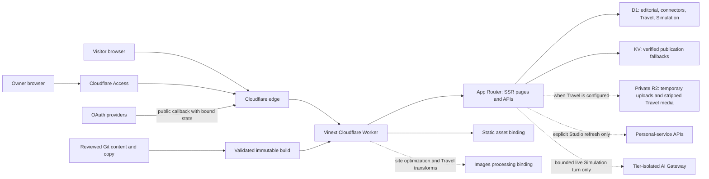
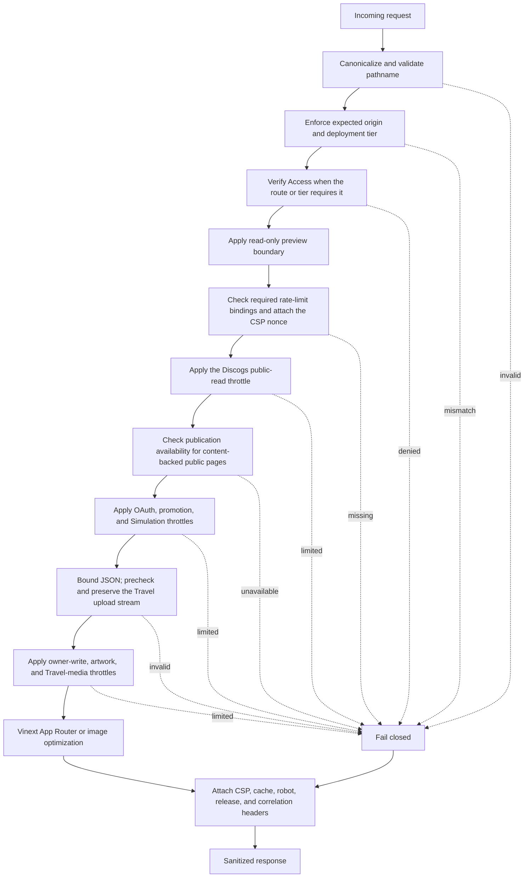
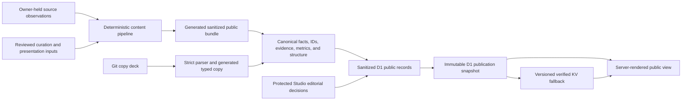
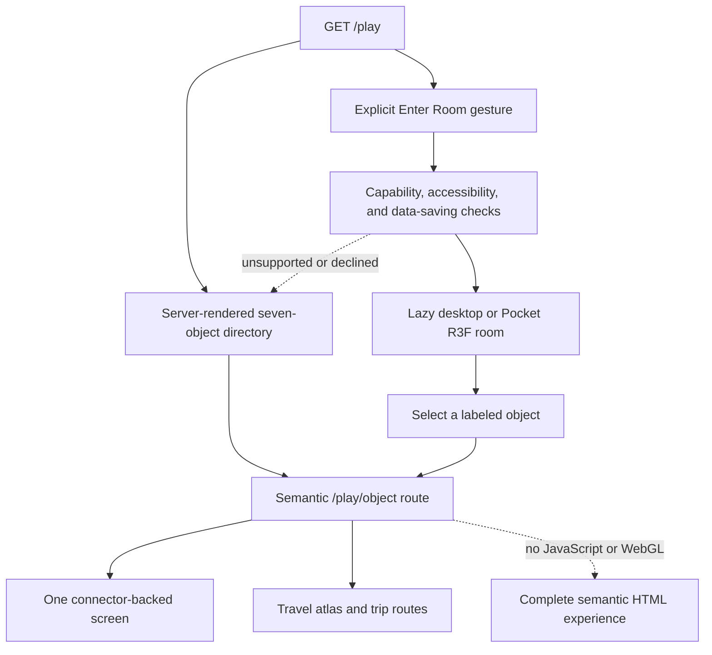

# Codebase tour

This repository is both a public portfolio and a small owner-operated publishing
system. A visitor sees server-rendered Work, Sources, Play, Travel, and optional
Simulation experiences. Behind those pages, a protected Studio curates public
records, refreshes personal-service snapshots, publishes Travel, and records the
approvals needed by the Simulation.

The useful mental model is **one public application with several deliberately
separate state machines**:

- canonical portfolio content is generated and sanitized before deployment;
- editorial publication selects and qualifies that content in D1, with a
  verified KV fallback;
- Play connector snapshots are fetched only after an explicit owner action;
- Travel is an owner-authored D1/KV/R2 publication, not a connector; and
- Simulation sessions, budgets, and approvals are bounded D1 state, separate
  from both editorial publication and Play collection storage.

The boundaries matter more than any individual framework. They keep public
reads pure, owner actions auditable, rich media optional, and every hosted
environment isolated.

## System context

The deployed application is a Vinext build running inside one Cloudflare
Worker. The Worker is the security and environment boundary; the App Router is
the page and API boundary; D1, KV, R2, Images, provider APIs, and AI Gateway have
distinct responsibilities.

The single-Worker shape keeps deployment and observability compact. It also
means middleware is part of the product architecture: a page that works in a
local framework server has not yet proved its production origin, Access, CSP,
rate-limit, cache, or deployment-tier behavior.

D1 is the authoritative runtime store for structured mutable state. KV contains
only verified editorial and Travel publication fallbacks; connector snapshots
and Simulation sessions are not replicated there. Private R2 is used only for
Travel media and is never exposed as a public bucket. Images performs
transformations but owns no durable record or publication state.

## Request lifecycle

`worker/index.ts` wraps every application request before it reaches Vinext. The
order is intentional: reject untrusted shape and environment mistakes before
parsing a write or invoking application code.

After the preview boundary accepts a synthetic read, preview skips the hosted
rate-limit binding checks and throttles shown later in the main path. The
boundary has already rejected writes, Studio, OAuth, and promotion import.

Important consequences:

- preview deployments are authenticated, globally noindexed, fixture-only,
  and read-only;
- owner JSON writes are same-origin, authenticated, allowlisted, bounded, and
  returned with private no-store headers;
- Travel uploads are streamed through a separate bounded media path instead of
  being buffered as JSON;
- Play and Simulation HTML is private/no-store because it may contain
  publication-gated state; and
- unhandled failures become a redacted service response rather than exposing
  request or provider details.

The scheduled handler is a maintenance path, not a synchronization path. It
runs connector, Simulation, and Travel retention in sequence. It never calls a
provider collection API.

## Content and state

The repository distinguishes facts, presentation, publication, and recovery.
That distinction prevents a convenient editing surface from quietly becoming a
new source of truth.

Authority is field-specific:

1. The sanitized canonical bundle owns facts, stable IDs, routes, relations,
   evidence, metrics, and structure.
2. Published D1 state owns allowlisted visibility, ordering, featured state,
   caveats, and metric wording.
3. `content/copy/**` owns only declared page and WorkGroup presentation fields.

`content/public/anish-content.public.v1.json` is generated deployable content;
it is never an editing surface. Raw inputs and `content/private` stay outside
public output. `CONTENT_VERSION` identifies canonical data, while
`COPY_VERSION` identifies the reviewed copy contract and sources.

At runtime, `lib/server/public-content.ts` applies the Git-owned copy fields to
the sanitized base and resolves the active D1 publication. The selector
validates snapshot shape, base content version, record identity, public
projection, and content hash before rendering. Hosted public mode fails closed
when neither D1 nor the verified KV fallback can supply a valid publication.

## Play as progressive enhancement

My Room 2001 is a semantic route system first and a 3D room second. A
dependency-free contract defines seven objects and derives their route, focus,
mesh, and smoke-test identities. Executable imports remain literal closed maps,
so URL or provider data never becomes an import specifier.

The seven objects are Watch, Read, Listen, Collect, Play, Move, and Travel.
The first six pair one literal room screen with one server adapter. Travel owns
its concrete route because atlas queries, trip pages, fixtures, and metadata
have a different contract. `/play` itself performs no connector or Travel data
read and does not preload provider, geography, media, or room-runtime data.

Three.js/R3F is restricted to the intent-gated room and Travel globe. The
Canvas is decorative; direct links, focus, browser Back, Escape, and semantic
controls remain authoritative. A coarse pointer does not by itself force the
static experience: a device not admitted to the desktop tier can still enter
the touch-oriented Pocket Room when it clears the independent size,
reduced-motion, forced-colors, Save-Data, zoom, visibility, and WebGL checks.
Context loss still returns the experience to its semantic fallback.
There is no alternate Classic mode; only bounded legacy query redirects remain.

## Repository map

| Path | Owns | Boundary to preserve |
| --- | --- | --- |
| `app/**` | App Router pages, metadata, route composition, thin API exports | Keep route files thin and server-render semantic foundations |
| `app/play/**` | Play overview, six connector object routes, Travel routes | `/play` reads no collections; each direct route loads one source |
| `app/simulation/**` | Simulation route gate and server-rendered campaign foundation | Disabled and coming-soon modes must not initialize campaign state |
| `app/studio/**` | Owner operational UI and Travel Desk | Git copy is read-only here; mutations go through protected APIs |
| `app/api/studio/**` | Canonical owner reads and writes | Same-origin, Access, owner allowlist, bounded exact validation |
| `app/api/connectors/**` | Public reads, exact OAuth callbacks, compatibility redirects | No new owner mutation authority and no collection fetch on read |
| `components/**` | Public UI, Play screens, room, Travel, Simulation, shared audio | Rich runtimes stay scoped, lazy, accessible, and nonessential |
| `lib/server/connectors/**` | Credentials, OAuth, provider clients, locks, snapshots, projectors | Explicit owner refresh is the only collection-fetch authority |
| `lib/server/travel/**` | Travel policy, drafts, projection, publication, media, retention | Travel remains separate from connectors and exact locations stay private |
| `lib/server/simulation/**` | Campaign policy, sessions, budgets, approvals, grounding, Gateway | Facts are server-owned; raw visitor/model text is never persisted |
| `lib/server/public-content*` | Publication selection, validation, and fallback | Checked-in content is not an automatic hosted fallback |
| `worker/**` | Origin/tier boundary, Access, security headers, limits, observability, cron | Security behavior belongs here, not only in route handlers |
| `content/**` | Generated public data, reviewed curation, copy, presentation manifests | Never hand-edit generated or private artifacts |
| `drizzle/**` | Ordered D1 schema history | Migrations are additive and immutable after application |
| `scripts/**` | Generation, validation, environment plans, release controls | Plans may inspect; hosted mutation stays explicit and exact-SHA guarded |
| `tests/**` | Content, backend/security, rendered, environment, and browser contracts | Test public purity and failure behavior, not just success paths |

The main public route groups are deliberately conventional: Home, About, Work
and its detail pages, Sources, Privacy, Play and its objects, Travel trip pages,
and the gated Simulation. About is a short, Git-owned professional chronology;
Home remains the canonical `Person` identity and About references that identity
through `ProfilePage` structured data. Studio is a separate owner plane, even
though it ships in the same application.

Work's organization index is a reviewed presentation layer, not a relationship
inference engine. Its manifest maps a normalized mark to exact public
organization and WorkGroup IDs, and runtime resolution drops hidden or empty
groups before counts and links are rendered. A typographic fallback is used
when an official first-party brand asset cannot be safely checked in.

## Connector boundary

Five collection providers use the generic connector repository:
MyAnimeList, Hardcover, Spotify, Discogs, and Steam. Strava stores a validated
public profile and optional official embed in a separate module; it is not a
generic collection snapshot.

The collection lifecycle is:

1. The owner connects or replaces a credential in Studio. OAuth completion or
   credential save does not fetch a collection.
2. The owner explicitly chooses **Refresh**.
3. The server acquires a provider-scoped D1 lock, decrypts the current
   credential generation, and makes one bounded provider attempt.
4. Provider-specific code reduces the response to an exact public payload.
5. A central public-payload policy validates that projection before D1 stores a
   ready snapshot and audit record.
6. Public APIs and Play screens read the stored snapshot, project pagination or
   gallery state, and apply the provider's publication choice and unified
   encrypted approval gate.

Non-manual trigger values remain parseable only for historical database
compatibility; the refresh service rejects them at runtime. Public reads,
OAuth callbacks, credential saves, and scheduled maintenance are pure with
respect to provider collections. Failed attempts keep the last-known-good
snapshot, except for an explicit visibility-withheld state where retaining a
collection would itself be misleading.

Configured providers begin in report-only approval mode so deployment cannot
silently hide existing collections. Studio records encrypted, provider-bound
references for `public_display` and `retain_last_known_good`; activation becomes
available only when every configured provider has both scopes. In required
mode, a missing, disabled, or expired approval withholds public display without
deleting the private snapshot. Accepted connector snapshots do not age out;
their actual update time and stale state remain visible until replacement,
explicit unpublish, disconnect, or Steam's verified-private tombstone.

This design favors privacy, predictable provider load, and inspectable owner
intent over minute-by-minute freshness. It also makes stale and unavailable
states part of the public contract rather than errors to hide.

## Travel boundary

Postcard Planet is authored publication state:

- D1 stores trip, place, photo, upload, publication, and cleanup records.
- KV stores only versioned sanitized publication fallback envelopes.
- A private, tier-specific R2 bucket briefly stores raw upload candidates and
  stores stripped WebP masters and derived variants.
- Cloudflare Images performs orientation, scaling, and metadata removal.
- `TRAVEL_ATLAS_MODE` gates route availability without itself publishing data.

Travel Desk issues a short-lived one-time upload transaction tied to a trip
revision. The streamed upload is bounded and inspected before Images produces a
metadata-free master. Exact GPS and original filenames remain browser-local
review suggestions; public places are owner-selected coarse geography.

Publishing replaces one trip inside the complete atlas projection, validates
the whole result, hashes it, stages the fallback, and compare-and-swaps the D1
active pointer and trip revision. Planned and current trips are limited to
month-level country/region geography and no photos. Completed trips may include
reviewed photos and owner-approved approximate-city points.

Images is a processing binding, not a source of record or publication state.
General site-image optimization can return its result directly; Travel writes
validated processed masters and derivatives to private R2. Public media uses
an opaque photo ID, a closed size variant, and a digest. The
endpoint verifies the photo and digest against the current D1 publication
*before* looking up an R2 master or derivative. Thus KV may preserve atlas text
during a D1 incident, but it cannot preserve access to an unpublished image.

The globe is optional, route-local enhancement over a complete semantic
country/region/trip hierarchy. See [Postcard Planet travel atlas](../travel-atlas.md)
for media and geography details.

## Simulation boundary

The Simulation has three exact experience modes: `disabled`, `coming-soon`,
and `campaign-v1`. These are configuration contracts, not statements about
which mode any hosted environment currently serves.

In the complete campaign:

- the server resolves a checked-in encounter manifest against the active
  sanitized publication;
- XState owns campaign transitions, while the React controller owns request
  queuing, cancellation, and browser lifecycle;
- Tactical mode stays semantic React UI;
- Phaser is imported only after Action mode is selected;
- Tone/Web Audio is imported and started only after an explicit `SOUND ON`
  gesture; and
- the no-JavaScript dossier and evidence remain readable without game code.

A session cookie contains a random opaque token; D1 stores only its HMAC,
revision, allowlisted state, bounded counters, request IDs, a short generation
lease, expiry, and an exact-validated response projection for idempotency. Raw
optional visitor text, prompts, and raw provider responses remain in memory and
never enter D1, KV, audit records, logs, analytics, or session storage.

Each turn validates the action and optional text, reserves the expected session
revision, resolves facts from the active publication, checks any owner-only
provider approval, applies per-session and daily budgets, and optionally calls
an environment-specific AI Gateway. Model output can select only allowlisted
IDs and enums; trusted fact cards are rendered from server-owned data. Timeout,
provider failure, budget exhaustion, missing approval, or invalid output uses
the complete authored fallback.

This design spends more code on validation and fallback than on prompting. The
tradeoff is deliberate: generated prose may add texture, but it cannot become a
new factual authority. See [Meet Me: 4N1SH simulation](./meet-me-simulation.md)
for the complete session and transport contract.

## Environment isolation

The same source has five operational contexts, but their data and authority do
not flow into one another. This table states the required and allowed tier
contract; it does not report which optional feature mode is live.

| Context | Purpose | State and network boundary |
| --- | --- | --- |
| Local | Development and owner setup | Loopback, local D1 and local-only configuration; no hosted identity assumptions |
| PR preview | Review code and presentation safely | Access-protected synthetic fixtures; no D1, KV, R2, Studio, OAuth, provider calls, Gateway, secrets, or cron |
| Staging | Validate the real hosted shape | Must use dedicated Worker, D1, KV, R2, Images, rate limits, Access, provider registrations, and Gateway resources; globally noindexed |
| Production | Serve the owner-controlled public site | Must use separate production resources and Access-protected owner surfaces; exact-SHA release guard |
| Private Sites reference | Recovery and visual reference | Private and isolated; never a public proxy or production rollback target |

Feature modes are generated into each environment's exact configuration. They
must not be inferred from another tier or copied with its data. Local and hosted
D1, KV, R2 objects, encryption keys, OAuth material, connector snapshots,
Simulation approvals, and Gateway coordinates remain isolated.

The cost is duplicated setup and more explicit release evidence. The benefit is
that preview convenience, staging tests, and local experimentation cannot
silently become a path into public state.

## Release path

CI first classifies a change so focused work does not always pay for every
browser and deployment check. Content, connectors, Room, Travel, Simulation,
Worker security, migrations, docs, and release code each select their own
bounded gates; cross-domain changes use the full validation path.

A production candidate has a stronger contract:

1. Pin a clean pushed `release/<semver>` commit.
2. Require exact-SHA evidence from Validate, Gitleaks, CodeQL, and Browser
   Quality.
3. Build or retrieve one hashed immutable deployable artifact and reuse those
   exact bytes for rendered, browser, bundle, planning, and release checks.
4. Generate an environment plan that verifies resource isolation, additive
   migrations, versions, feature-mode values, and the prior Worker checkpoint.
5. Stage the candidate without immediately replacing the prior version, apply
   only the reviewed staging train, bootstrap bounded maintenance when needed,
   and record a guarded checkpoint.
6. Run the registry-derived smoke set against the exact candidate.
7. Treat any production promotion as a separate, explicitly authorized action.

Release records include `RELEASE_VERSION`, `CONTENT_VERSION`, `COPY_VERSION`,
`TRAVEL_ATLAS_MODE`, `SIMULATION_EXPERIENCE_MODE`, and `SIMULATION_AI_MODE`.
Worker rollback and D1 restoration are separate decisions: code can be
re-promoted without assuming database state should move backward.

Scheduled retention is intentionally modest, but it is sequential. An early
cleanup exception ends that invocation before later cleanup runs, so sanitized
health, maintenance heartbeats, staging checkpoints, and retry on the next
schedule are part of operational confidence.

## Architectural tradeoffs

| Decision | What it buys | What it costs |
| --- | --- | --- |
| One Worker for pages, APIs, middleware, and maintenance | Small deployment surface and one policy boundary | Shared failure domain and careful bundle isolation |
| Semantic SSR before Canvas/WebGL | Indexable, accessible, no-JavaScript-complete experiences | Rich runtimes must duplicate some visible state and synchronization |
| Closed registries for Play screens and adapters | Route/source isolation and parity tests | Adding an object requires coordinated explicit changes |
| Manual-only connector synchronization | Clear consent, bounded provider load, stable snapshots | Public data can be stale between owner refreshes |
| D1 authority plus verified KV fallback | Durable editorial reads during a D1 incident | Version, hash, pointer, and cleanup protocols must stay aligned |
| D1-only authorization for Travel media | Immediate unpublish and no stale-KV media leak | Media availability intentionally fails closed during D1 loss |
| Strict Simulation grounding and authored fallback | Generated prose cannot invent public facts or block the campaign | More server policy and less open-ended model behavior |
| Fully isolated hosted tiers | Strong privacy and meaningful staging evidence | Duplicate resources, registrations, and operational setup |

## Where to go deeper

- [Architecture overview](./overview.md) describes the deployment and storage
  model at a higher level.
- [Content and state](./content-and-state.md) details publication ownership and
  migration discipline.
- [Postcard Planet travel atlas](../travel-atlas.md) covers Travel geography,
  media processing, and fallback behavior.
- [Meet Me: 4N1SH simulation](./meet-me-simulation.md) covers campaign,
  session, grounding, and AI transport policy.

When tracing a change, start at the authority listed in the repository map,
follow its public projector into a route, and then find the corresponding
failure-path test. That path is usually more informative than starting from a
rendered component and working backward.
